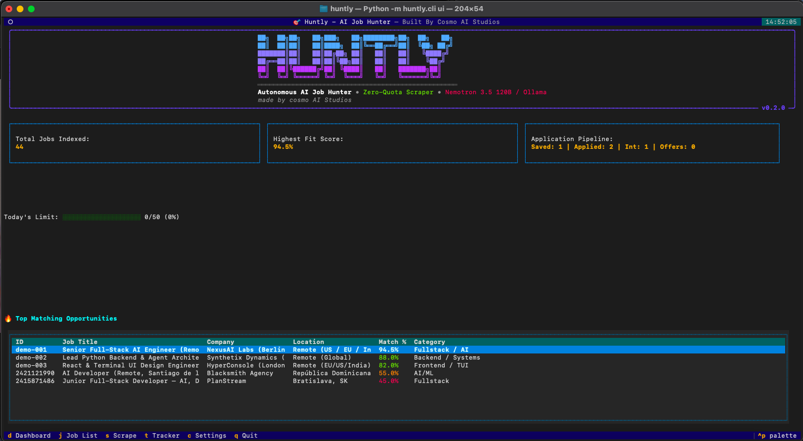
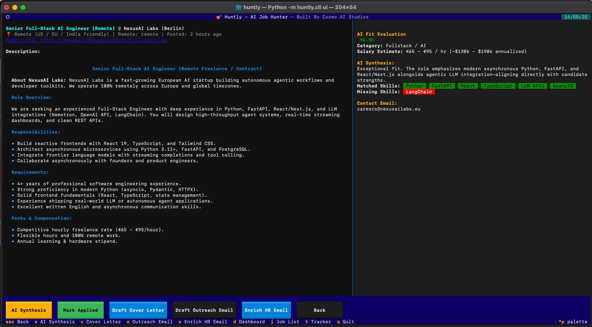
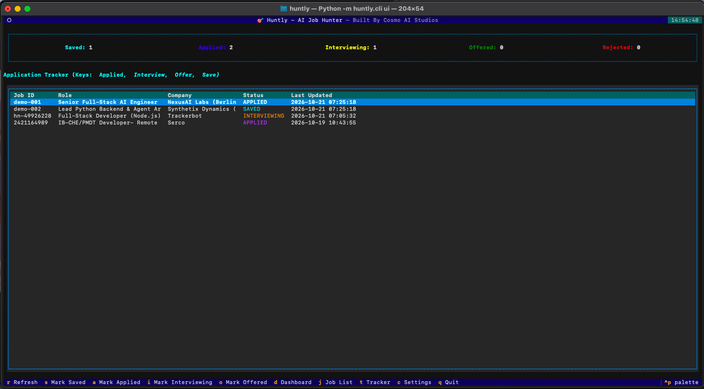
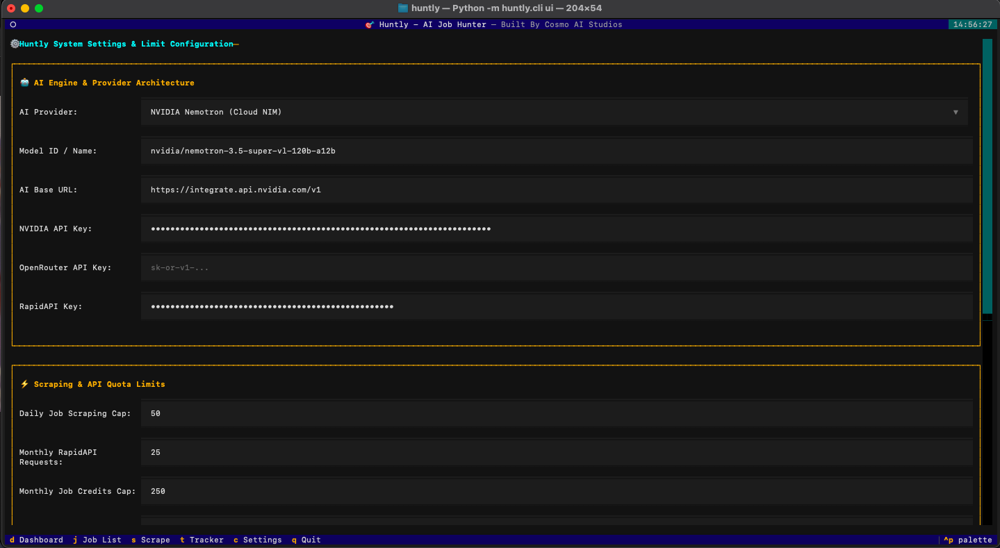
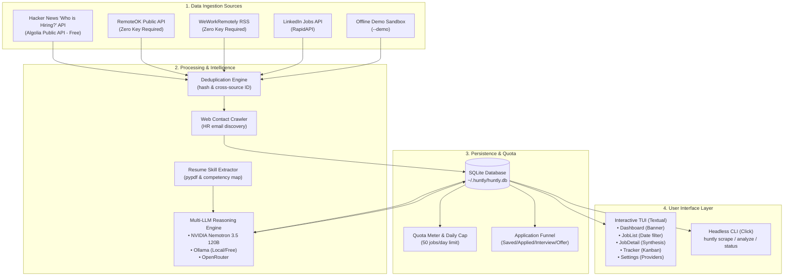

<div align="center">

```text
██╗  ██╗██╗   ██╗███╗   ██╗████████╗██╗  ██╗   ██╗
██║  ██║██║   ██║████╗  ██║╚══██╔══╝██║  ╚██╗ ██╔╝
███████║██║   ██║██╔██╗ ██║   ██║   ██║   ╚████╔╝ 
██╔══██║██║   ██║██║╚██╗██║   ██║   ██║    ╚██╔╝  
██║  ██║╚██████╔╝██║ ╚████║   ██║   ███████╗██║   
╚═╝  ╚═╝ ╚═════╝ ╚═╝  ╚═══╝   ╚═╝   ╚══════╝╚═╝   
═══════════════════════════════════════════════════
Autonomous AI Job Hunter • Zero-Quota Scraper • Nemotron 3.5 120B / Ollama
made by cosmo AI Studios
```

# 🎯 Huntly — Autonomous AI Job Hunter
### *High-Leverage Terminal AI Agent for Remote Software Engineers & Freelancers*
**Built By Cosmo AI Studios**

[](https://www.python.org/)
[](https://www.gnu.org/licenses/gpl-3.0)
[](https://buymeacoffee.com/cosmoai)
[](https://textual.textualize.io/)
[](https://build.nvidia.com)
[](https://github.com/cosmoaistudios-netizen/huntly/actions)
[](https://github.com/astral-sh/ruff)

[Live Demo Video](#-video-walkthrough) • [Key Features](#-key-features) • [Visual Tour](#-visual-tour) • [Quick Start](#-quick-start) • [Free Mode](#-zero-cost-free-mode) • [Support & Donations](#-support--donations) • [Architecture](#-system-architecture) • [CLI Reference](#-cli-reference) • [Keybindings](#-tui-keybindings--navigation)

</div>

---

## 💡 Why Huntly?

Searching for high-paying remote contract, freelance, or full-time engineering roles across US and European startups is tedious:
- **Generic job boards** return hundreds of stale, irrelevant, or onsite listings.
- **Application black holes** hide hiring managers behind automated ATS filters.
- **Crafting tailored cover letters** and analyzing role fit takes hours for each application.
- **Expensive scraping APIs** have strict monthly quotas that can be quickly exhausted.

**Huntly transforms your terminal into an autonomous job hunting control center**:
1. **Multi-Source Ingestion**: Aggregates fresh remote listings from **Hacker News "Who is Hiring?" API**, **RemoteOK API**, **WeWorkRemotely RSS feeds** (completely free & public with zero API keys), alongside **LinkedIn Search API**.
2. **Local Resume Fit Synthesis**: Automatically evaluates job requirements against your local PDF resume using frontier **NVIDIA Nemotron 3.5 120B**, local **Ollama** (100% private & free), or **OpenRouter**.
3. **Automated HR Contact Discovery**: Crawls company domains (`/`, `/careers`, `/jobs`, `/contact`, `/team`) to discover direct recruiter and founder email addresses.
4. **Tailored Asset Drafting**: Generates bespoke 3-paragraph cover letters and high-converting cold outreach messages on demand.
5. **Built-in Kanban Funnel**: Tracks applications across **Saved**, **Applied**, **Interviewing**, and **Offered** states directly from the keyboard.

---

## 📹 Video Walkthrough

Watch Huntly in action—demonstrating real-time scraping, AI resume evaluation, contact enrichment, and document generation:

https://github.com/user-attachments/assets/demo-walkthrough

> 🎬 **Direct Video File**: You can also watch or play the local high-resolution demo at [`assets/demo.mov`](assets/demo.mov).

---

## 📸 Visual Tour

### 1. Launch Dashboard & System Telemetry
The main command center features an ASCII launch banner, live scraping quota meters, pipeline status counters, and top matching opportunities sorted by fit score.

<p align="center">
  
</p>

### 2. Deep AI Fit Evaluation & Synthesis
Inspect any job listing alongside an AI-synthesized breakdown: compatibility percentage badge, extracted salary estimates, matched technical skills, missing competencies, and direct HR contact discovery.

<p align="center">
  
</p>

### 3. Application Pipeline & Funnel Tracker
Manage your active application pipeline through an interactive table with real-time status updates (<kbd>Saved</kbd> ➔ <kbd>Applied</kbd> ➔ <kbd>Interviewing</kbd> ➔ <kbd>Offered</kbd>).

<p align="center">
  
</p>

### 4. Multi-LLM Provider & Quota Settings
Seamlessly switch between **NVIDIA Nemotron 3.5 120B**, local private **Ollama**, and **OpenRouter**, while configuring custom daily scraping caps and monthly credit budgets.

<p align="center">
  
</p>

---

## ✨ Key Features

* 🆓 **Zero-Credential Public Scrapers**: Scrape remote roles immediately from Hacker News, RemoteOK, and WeWorkRemotely without needing RapidAPI keys or credit cards.
* 🧠 **Multi-LLM Reasoning Engine**: First-class support for **NVIDIA Nemotron 3.5 Super VL 120B**, **Ollama** (`llama3.2`, `mistral`, `deepseek-r1`), and **OpenRouter**.
* ⚡ **Date Added Filtering & Multi-Column Sorting**: Filter postings by timeframe (*Past 24 Hours*, *3 Days*, *7 Days*, *30 Days*, or *All Time*) and sort by *Match Score*, *Date Added*, *Company*, or *Title*.
* 🌐 **Company Website Contact Crawler**: Discovers verified `careers@`, `jobs@`, or founder email addresses directly from employer domains.
* 📝 **Instant Cover Letter & Outreach Generation**: Drafts tailored cover letters and cold outreach messages formatted to your background and the specific role.
* 🛡️ **Budget & Rate Limit Protection**: Enforces configurable daily scraping caps (e.g. 50 jobs/day) and monitors monthly API credits.
* 🚀 **Zero-Key Offline Sandbox**: Test-drive the complete terminal interface with realistic pre-evaluated startup listings using `./run.sh demo`.

---

## ⚡ Quick Start

### 1. Prerequisites
- **Python**: `>= 3.9` (Python 3.9, 3.10, 3.11, or 3.12)
- **macOS / Linux / Windows WSL**

### 2. Installation

Clone the repository and set up a virtual environment:

```bash
# Clone the repository
git clone https://github.com/cosmoaistudios-netizen/huntly.git
cd huntly

# Create and activate a virtual environment
python3 -m venv .venv
source .venv/bin/activate  # On Windows: .venv\Scripts\activate

# Install Huntly in editable development mode
pip install -e .
```

### 3. Launching Huntly

Huntly provides an execution wrapper script (`run.sh`) that sets up environment variables and launches the app:

```bash
# Launch interactive TUI
./run.sh
# or via direct CLI
huntly ui
```

---

## 🆓 Zero-Cost Free Mode

You can run Huntly **100% free with zero API keys and zero cloud subscriptions**:

### Step 1: Use Free Job Sources
Scrape directly from public Hacker News and RSS feeds:
```bash
./run.sh scrape --source all_free --query "python" --limit 15
```

### Step 2: Use Local Ollama for AI Evaluations
1. Install [Ollama](https://ollama.ai/) and pull a model:
   ```bash
   ollama pull llama3.2
   ```
2. Open Settings in Huntly (<kbd>c</kbd>) or edit `~/.huntly/config.yaml`:
   ```yaml
   ai:
     provider: "ollama"
     model: "llama3.2"
     base_url: "http://localhost:11434/v1"
   ```
3. Huntly will perform all resume analyses and cover letter drafts completely on your machine.

---

## 🔑 Cloud Mode (NVIDIA Nemotron & RapidAPI)

To enable cloud frontier reasoning with NVIDIA Nemotron 3.5 120B and LinkedIn search:

1. Copy the example environment file:
   ```bash
   cp .env.example .env
   ```
2. Add your API keys to `.env` (or enter them directly in **Settings (`c`)** inside the TUI):
   ```env
   # NVIDIA Build NIM API Key (Free tier credits available at https://build.nvidia.com)
   NVIDIA_API_KEY=nvapi-your_key_here

   # RapidAPI Key for LinkedIn Job Search (Optional)
   # Subscribe & generate your key at: https://rapidapi.com/fantastic-jobs-fantastic-jobs-default/api/linkedin-job-search-api
   RAPIDAPI_KEY=your_rapidapi_key_here

   # OpenRouter Key (Optional, get at https://openrouter.ai/keys)
   OPENROUTER_API_KEY=sk-or-your_key_here
   ```

   > [!TIP]
   > For the optional LinkedIn scraper, Huntly connects to the [LinkedIn Job Search API on RapidAPI](https://rapidapi.com/fantastic-jobs-fantastic-jobs-default/api/linkedin-job-search-api). You can create a free RapidAPI account, subscribe to the API plan, and paste your personal `RAPIDAPI_KEY` into Huntly.

3. Set your resume path in `~/.huntly/config.yaml` or Settings screen:
   ```yaml
   resume:
     path: "/path/to/your/resume.pdf"
   ```

---

## 🏛️ System Architecture



---

## 💻 CLI Reference

Huntly includes a full-featured command-line suite for scriptable workflows:

```bash
# Display system telemetry, daily cap consumption, and quota
huntly status

# Scrape jobs using free public sources (zero quota consumed)
huntly scrape --source all_free --query "fullstack" --limit 15
huntly scrape --source hn --query "ai engineer" --limit 10
huntly scrape --source remoteok --query "devops" --limit 10
huntly scrape --source wwr --query "backend" --limit 10

# Run AI synthesis and fit evaluation on unanalyzed jobs in database
huntly analyze --limit 5

# Batch-crawl company domains to discover direct HR emails
huntly enrich --limit 5

# Display top matching opportunities ranked by AI fit score
huntly top --limit 10

# Inspect parsed resume skills and competencies
huntly resume

# Launch zero-key offline interactive demonstration sandbox
huntly demo
```

---

## ⌨️ TUI Keybindings & Navigation

### Global Screen Shortcuts
| Key | Screen | Description |
|:---:|:---|:---|
| <kbd>d</kbd> | **Dashboard** | ASCII banner, quota gauges, pipeline metrics, and top recommendations |
| <kbd>j</kbd> | **Job List** | Searchable table with Date Added, Source, and Sort By filters |
| <kbd>s</kbd> | **Scrape Panel** | On-demand scraper panel supporting all free and API sources |
| <kbd>t</kbd> | **Tracker** | Interactive application funnel (<kbd>Saved</kbd>, <kbd>Applied</kbd>, <kbd>Interviewing</kbd>, <kbd>Offered</kbd>) |
| <kbd>c</kbd> | **Settings** | Configure AI providers (Nemotron, Ollama, OpenRouter), keys, and caps |
| <kbd>q</kbd> | **Quit** | Exit Huntly |

### Job List Screen (<kbd>j</kbd>)
- <kbd>Enter</kbd> / Click: Open full **Job Detail Screen**.
- Dropdowns: Filter by **Date Added** (*24h*, *3d*, *7d*, *30d*, *All Time*) and **Source** (*All*, *LinkedIn*, *Hacker News*, *RemoteOK*, *WeWorkRemotely*).
- <kbd>e</kbd>: Crawl domain for HR contact email.
- <kbd>a</kbd>: Move job to **Applied** pipeline.
- <kbd>r</kbd>: Refresh table listings.

### Job Detail Screen
- <kbd>s</kbd>: **Run AI Synthesis** (evaluates role fit live against your resume).
- <kbd>c</kbd>: Draft tailored 3-paragraph **Cover Letter**.
- <kbd>o</kbd>: Generate personalized cold **Outreach Email**.
- <kbd>e</kbd>: Run web contact crawler for HR email.
- <kbd>Escape</kbd>: Return to Job List.

---

## ⚙️ Configuration Reference

Huntly persists local configuration at `~/.huntly/config.yaml`:

```yaml
ai:
  provider: "nvidia" # "nvidia", "ollama", or "openrouter"
  model: "nvidia/nemotron-3.5-super-vl-120b-a12b"
  base_url: "https://integrate.api.nvidia.com/v1"
  temperature: 0.2
  max_tokens: 4096

limits:
  daily_job_limit: 50        # Daily cap to safeguard your budget
  monthly_requests_limit: 25 # RapidAPI request ceiling
  monthly_jobs_limit: 250    # Total monthly jobs limit
  jobs_per_request: 10       # Default batch scrape limit

display:
  match_threshold_green: 80  # Score >= 80% highlighted Green
  match_threshold_yellow: 50 # Score >= 50% highlighted Yellow
  theme: "dark"

resume:
  path: "/Users/yourname/Downloads/resume.pdf"
```

---

## 🧪 Testing & Quality Assurance

Huntly features a comprehensive 27-test suite covering CLI commands, headless TUI event handling, SQLite schema migrations, and live scraper endpoints:

```bash
# Run the complete test suite
pytest tests/
```

Test coverage includes:
- `tests/test_cli_commands.py`: Click CLI invocation, arguments, and exit codes.
- `tests/test_tui_screens.py`: Headless Textual pilot testing across all screens and keybindings.
- `tests/test_e2e_db.py`: SQLite initialization, deduplication, and pipeline transactions.
- `tests/test_e2e_scrapers_and_ai.py`: Live network smoke tests for HN, RemoteOK, and WWR.
- `tests/test_multi_provider.py`: Model parameter propagation for Ollama and OpenRouter.

---

## 🛡️ Security & Privacy

- **100% Local-First**: Your resume, job database, cover letters, and notes remain stored strictly on your local filesystem in SQLite (`~/.huntly/huntly.db`).
- **Zero Third-Party Telemetry**: Huntly does not collect analytics, telemetry, or user behavior logs.
- **Credential Protection**: API keys are loaded via local `.env` files that are strictly excluded from version control.

---

## 💖 Support & Donations

Huntly is an independent, 100% open-source software project dedicated to giving software engineers control over their careers with zero tracking, transparent AI synthesis, and complete local privacy.

If Huntly helps you land interviews, streamlines your job search, or saves you hours every week, consider supporting our ongoing development:

<div align="center">

[](https://buymeacoffee.com/cosmoai)

</div>

- ☕ **Buy Us a Coffee**: [buymeacoffee.com/cosmoai](https://buymeacoffee.com/cosmoai)
- 📬 **Direct Contact & Inquiries**: [cosmoaistudios@gmail.com](mailto:cosmoaistudios@gmail.com)
- ⭐️ **Star the Repository**: Leave a star on [GitHub](https://github.com/cosmoaistudios-netizen/huntly) to help fellow engineers discover Huntly!

---

## 📄 License & Attribution

Distributed under the **GNU General Public License v3.0 (GPL-3.0)**. See [`LICENSE`](LICENSE) for details.

**Crafted with pride by [Cosmo AI Studios](https://github.com/cosmoaistudios-netizen/huntly).**
